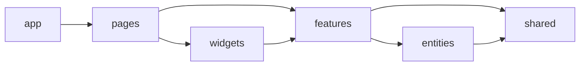
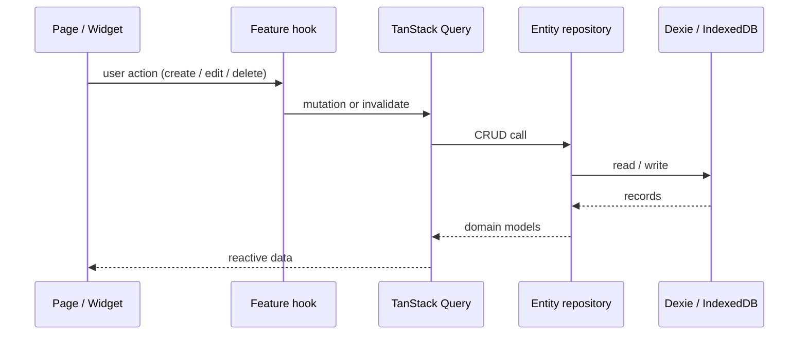

# Architecture

Noto is a **local-first** Vue 3 application organized with **Feature-Sliced Design (FSD)**. This document describes layers, data flow, persistence, and state ownership.

## Design goals

1. Keep notes usable offline with durable browser storage
2. Isolate UI composition from domain repositories
3. Prefer explicit features over a monolithic store
4. Make import/export a first-class backup path

## Layer overview (FSD)

| Layer        | Path           | Responsibility                                                                  |
| ------------ | -------------- | ------------------------------------------------------------------------------- |
| **app**      | `src/app`      | Bootstrap, router, i18n, providers, global styles, error boundary               |
| **pages**    | `src/pages`    | Route screens that compose widgets and features                                 |
| **widgets**  | `src/widgets`  | Large UI blocks (sidebar, header, editor workspace, command palette host)       |
| **features** | `src/features` | User scenarios: editing, page tree, search, theme, locale, trash, import/export |
| **entities** | `src/entities` | Domain types and repositories (`workspace`, `page`, `snapshot`)                 |
| **shared**   | `src/shared`   | UI kit, config constants, IndexedDB wrapper, helpers                            |

**Import rule (simplified):** higher layers may depend on lower layers; entities and shared must not import from features/pages/widgets.

## Bootstrap and routing

1. `main.ts` creates the Vue app, Pinia, TanStack Query, i18n, and router
2. `bootstrapApp()` reads onboarding meta from IndexedDB and ensures a workspace exists when onboarding is already complete
3. Router guard redirects incomplete onboarding to `/onboarding`; completed sessions cannot re-enter it
4. Primary routes:
   - `/onboarding` — public setup form
   - `/w/:workspaceId?` — workspace shell
   - `/w/:workspaceId/page/:pageId` — open page
   - `/trash`, `/settings` — trash and settings screens

## Data flow

### Writing in the editor

1. TipTap emits JSON document updates into `EditorWorkspace`
2. `useAutosave` debounces changes (`AUTOSAVE_MS`, default 1s)
3. On flush, the feature emits an update patch and may create a snapshot
4. `usePageMutations` persists via `pageRepository` and invalidates related queries
5. Header `EditorStatus` reflects `idle | saving | saved | error`

### Page tree

- `usePagesQuery` loads pages for the active workspace and builds a tree
- Mutations cover create, reorder, move, favorite, duplicate, soft-delete
- Sidebar favorites and recent lists are derived views over the same page records plus UI session state

## Persistence

| Store                     | Technology   | Contents                                                         |
| ------------------------- | ------------ | ---------------------------------------------------------------- |
| IndexedDB database `noto` | Dexie        | `workspaces`, `pages`, `snapshots`, `meta`                       |
| `localStorage`            | thin helpers | last workspace id, theme/locale preferences (via feature stores) |

Schema versioning lives in `NotoDatabase` (`shared/lib/db`). Bump `version()` and add `upgrade()` handlers when changing stores.

**Meta keys** (examples): onboarding completion flag used by the router guard.

**Soft delete:** pages set `isDeleted` / `deletedAt` instead of hard removal; trash restore clears those fields; purge removes the record.

## State ownership

| Concern                | Owner                        | Notes                                               |
| ---------------------- | ---------------------------- | --------------------------------------------------- |
| Serverless domain data | IndexedDB + repositories     | Source of truth for workspaces/pages/snapshots      |
| Async cache / sync     | TanStack Query               | Query keys like `['workspace', id]`, `['page', id]` |
| Ephemeral UI session   | Pinia `ui` store             | Sidebar open/collapsed, recent page ids             |
| Theme                  | `features/theme`             | Writes `data-theme` and `color-scheme` on `<html>`  |
| Locale                 | `features/locale` + vue-i18n | Updates `document.documentElement.lang`             |
| Form validation        | VeeValidate + Zod            | Onboarding and similar forms                        |

Pinia is intentionally **narrow**: durable content does not live in Pinia.

## Cross-cutting features

- **Search:** indexes titles and `plainText` for the command palette
- **Import/export:** validates workspace JSON (Zod schema, size limits, dangerous-key checks) and supports merge import
- **Markdown:** page-level export; import helpers convert common Markdown blocks to TipTap JSON
- **i18n:** locale packs under `src/app/i18n/locales/`

## Testing strategy

- **Unit:** domain helpers, repositories, and feature models with Vitest
- **Component / Storybook:** shared UI and selected feature pieces
- **E2E:** Playwright flows under `e2e/`, each clearing browser storage for isolation

## Extension points

- New entity → `entities/<name>` with types + repository, then wire features
- New user scenario → `features/<name>` consuming entities/shared only
- New screen → `pages/<name>` composing widgets/features and a router entry

When in doubt, keep business rules in entities/features and keep pages thin.
