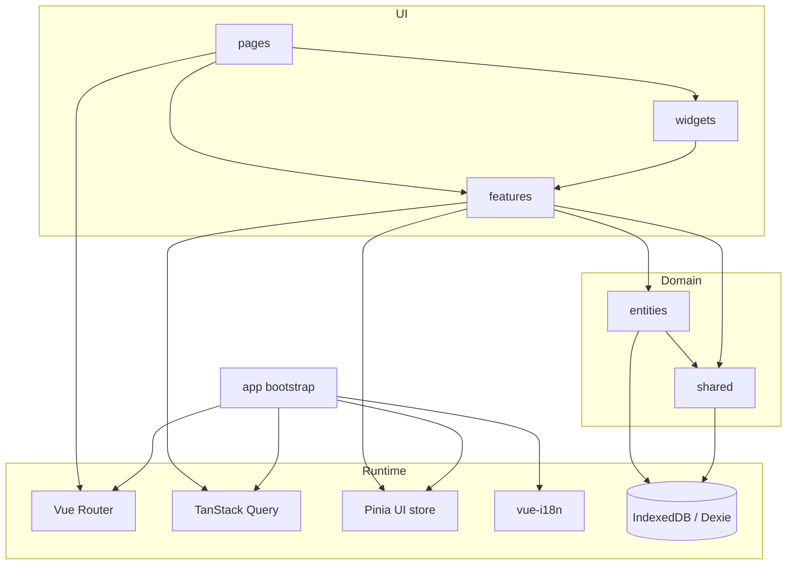

# Noto

[](https://github.com/PLACEHOLDER_GITHUB_OWNER/noto/actions/workflows/ci.yml)
[](https://github.com/PLACEHOLDER_GITHUB_OWNER/noto/actions/workflows/deploy.yml)
[](./LICENSE)
[](https://www.typescriptlang.org/)
[](https://vuejs.org/)
[](https://playwright.dev/)

**Local-first notes and documents workspace** — hierarchical pages, rich editing, favorites, trash, snapshots, and portable JSON/Markdown export. Data stays in your browser (IndexedDB) until you choose to export.

> **Live demo:** `https://PLACEHOLDER_GITHUB_OWNER.github.io/noto/`  
> Replace `PLACEHOLDER_GITHUB_OWNER` with your GitHub username or org after publishing.


_Add product screenshots under [`docs/screenshots/`](docs/screenshots/README.md). This README references them once captured — no fabricated assets or Lighthouse scores._

---

## Features

- **Local-first persistence** — workspaces, pages, and snapshots stored in IndexedDB via Dexie
- **Hierarchical page tree** — nest, reorder, and drag pages in the sidebar
- **Rich text editor** — TipTap/ProseMirror with headings, lists, tasks, quotes, code, links, slash commands, and bubble menu
- **Autosave** — debounced saves with a live status indicator
- **Favorites & recent pages** — quick access from the sidebar
- **Soft delete & trash** — restore or permanently purge deleted pages
- **Version snapshots** — short history per page with restore
- **Command palette search** — find pages by title and plain text (`Ctrl/⌘ + K`)
- **Import / export** — workspace JSON backup and per-page Markdown export
- **Themes** — light, dark, and system preference (`data-theme` on `<html>`)
- **i18n** — English and Russian UI
- **Responsive layout** — desktop sidebar and mobile drawer
- **Onboarding** — optional demo workspace with sample pages

---

## Architecture

Noto follows **Feature-Sliced Design (FSD)** with clear layers: `app` → `pages` → `widgets` → `features` → `entities` → `shared`.



See [ARCHITECTURE.md](./ARCHITECTURE.md) for data flow, persistence, and state details.

---

## Project structure

```text
src/
  app/           # bootstrap, router, i18n, providers, global styles
  pages/         # route-level screens (workspace, onboarding, settings, trash)
  widgets/       # composed UI blocks (sidebar, header, editor workspace, palette)
  features/      # user scenarios (editor, page-tree, search, theme, locale, …)
  entities/      # domain models & repositories (workspace, page, snapshot)
  shared/        # UI kit, config, IndexedDB, utilities
e2e/             # Playwright end-to-end specs
docs/            # documentation assets (screenshots guide)
.storybook/      # Storybook for shared UI
.github/         # CI, deploy, issue/PR templates
```

---

## Tech stack

| Area         | Choice                                                |
| ------------ | ----------------------------------------------------- |
| UI           | Vue 3, TypeScript, Vite, SCSS modules                 |
| State / data | Pinia (UI session), TanStack Query, Dexie (IndexedDB) |
| Editor       | TipTap 2 / ProseMirror                                |
| Forms        | VeeValidate + Zod                                     |
| i18n         | vue-i18n (EN / RU)                                    |
| Testing      | Vitest + Vue Test Utils, Playwright                   |
| Quality      | ESLint, Prettier, Husky, commitlint, Storybook        |
| Delivery     | Docker (nginx), GitHub Actions, GitHub Pages          |

---

## Requirements

- **Node.js** ≥ 22 (see `.nvmrc`)
- npm (lockfile committed)

---

## Getting started

```bash
git clone https://github.com/PLACEHOLDER_GITHUB_OWNER/noto.git
cd noto
npm ci
npm run dev
```

Open the URL printed by Vite (typically `http://localhost:5173`).

### Useful scripts

| Script                      | Description                                   |
| --------------------------- | --------------------------------------------- |
| `npm run dev`               | Vite development server                       |
| `npm run build`             | Typecheck + production build                  |
| `npm run preview`           | Preview the production build                  |
| `npm run lint` / `lint:fix` | ESLint                                        |
| `npm run format`            | Prettier write                                |
| `npm run typecheck`         | `vue-tsc`                                     |
| `npm run test`              | Vitest unit tests                             |
| `npm run test:coverage`     | Vitest with coverage                          |
| `npm run test:e2e`          | Playwright E2E (builds + previews on `:4173`) |
| `npm run storybook`         | Storybook on port 6006                        |

Environment variables are documented in [`.env.example`](./.env.example) (`VITE_BASE_URL`, `VITE_APP_TITLE`).

---

## Docker

Build and run the production image locally:

```bash
docker compose up --build
```

The app is served by nginx on **http://localhost:8080** (see `Dockerfile` and `docker/nginx.conf`). Health check: `/healthz`.

---

## Testing

- **Unit / component:** Vitest (`npm run test`, `npm run test:coverage`)
- **E2E:** Playwright specs in `e2e/*.spec.ts`
  - Each scenario clears `localStorage`, `sessionStorage`, and IndexedDB via `e2e/helpers.ts`
  - Stable selectors prefer `getByRole`, `getByLabel`, and `data-testid`
  - Install browsers once: `npx playwright install chromium`

```bash
npm run test:e2e
```

---

## Accessibility

- Semantic landmarks, labels, and dialogs for search and menus
- Icon-only controls expose accessible names (`aria-label`)
- Live region for autosave status (`role="status"`, `aria-live="polite"`)
- Keyboard support for command palette and dropdown menus
- Storybook a11y addon available for shared UI reviews

---

## Performance notes

- Route-level code splitting via dynamic imports in the router
- Debounced autosave (`AUTOSAVE_MS`) to limit IndexedDB writes
- Local-first model avoids network latency for CRUD
- Production build served as static assets (Vite + nginx)

_No fabricated Lighthouse scores are claimed in this README. Measure locally or in CI when you need numbers._

---

## CI / CD

- **CI** ([`.github/workflows/ci.yml`](./.github/workflows/ci.yml)): lint, typecheck, unit tests with coverage, production build, Storybook build, Playwright E2E
- **Deploy** ([`.github/workflows/deploy.yml`](./.github/workflows/deploy.yml)): publishes `dist` to GitHub Pages after a successful CI run on `main`/`master`
- **Dependabot** keeps npm and Actions dependencies current

---

## Roadmap

- [ ] Cloud sync / multi-device accounts (opt-in)
- [ ] Realtime collaboration
- [ ] Offline service worker / PWA install prompts
- [ ] Richer Markdown round-trip and attachments
- [ ] Shared templates gallery
- [ ] Additional locales

---

## Known limitations

- Data lives in the **browser profile**; clearing site data removes workspaces unless you export first
- No multi-user auth or server sync in v1
- Snapshots are capped per page; not a full version-control system
- Demo seed content is English-only
- Import size is bounded (see `MAX_IMPORT_BYTES` in import-export)

---

## Contributing

See [CONTRIBUTING.md](./CONTRIBUTING.md) and [CODE_OF_CONDUCT.md](./CODE_OF_CONDUCT.md). Architecture details: [ARCHITECTURE.md](./ARCHITECTURE.md).

---

## License

[MIT](./LICENSE) © 2026 Noto Contributors
